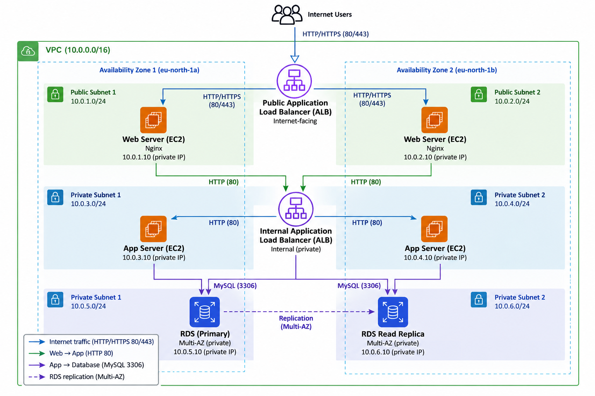
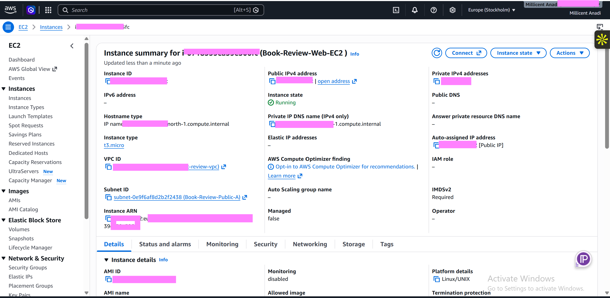
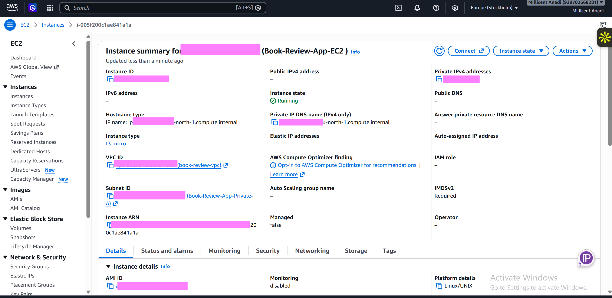
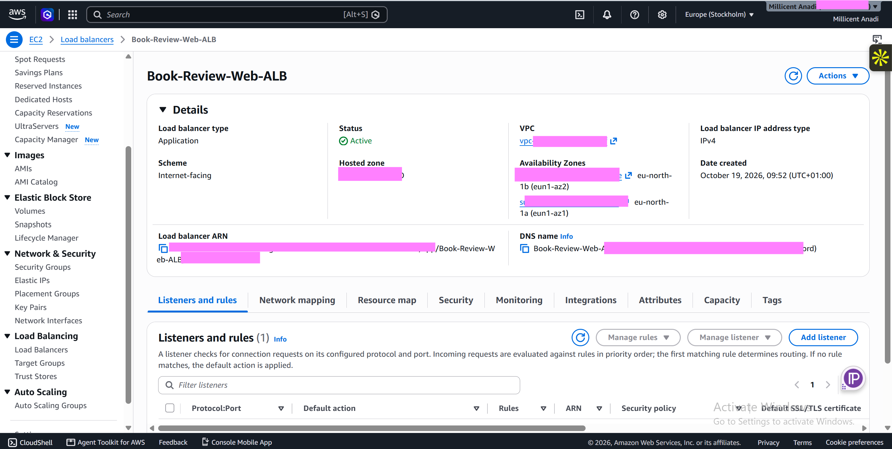
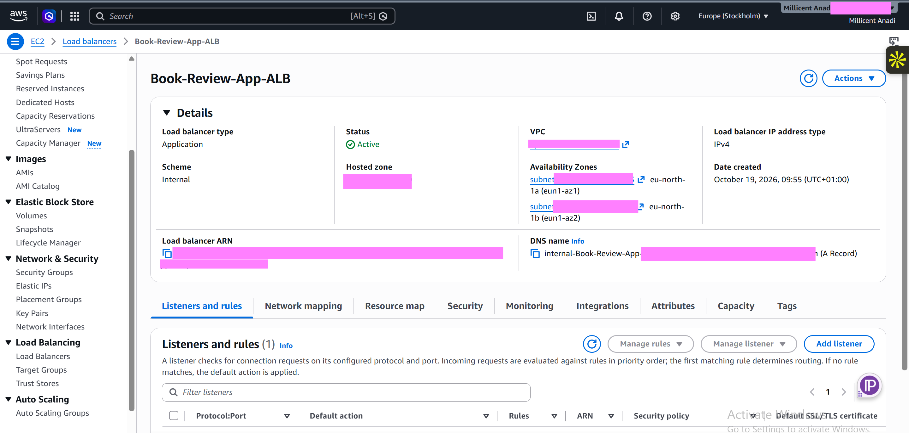
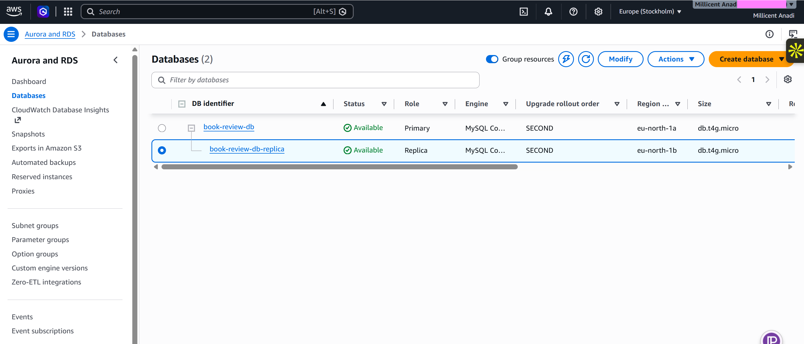
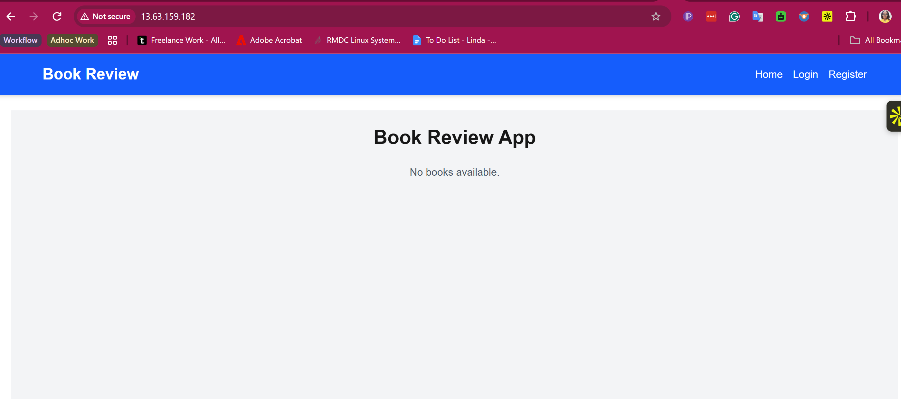
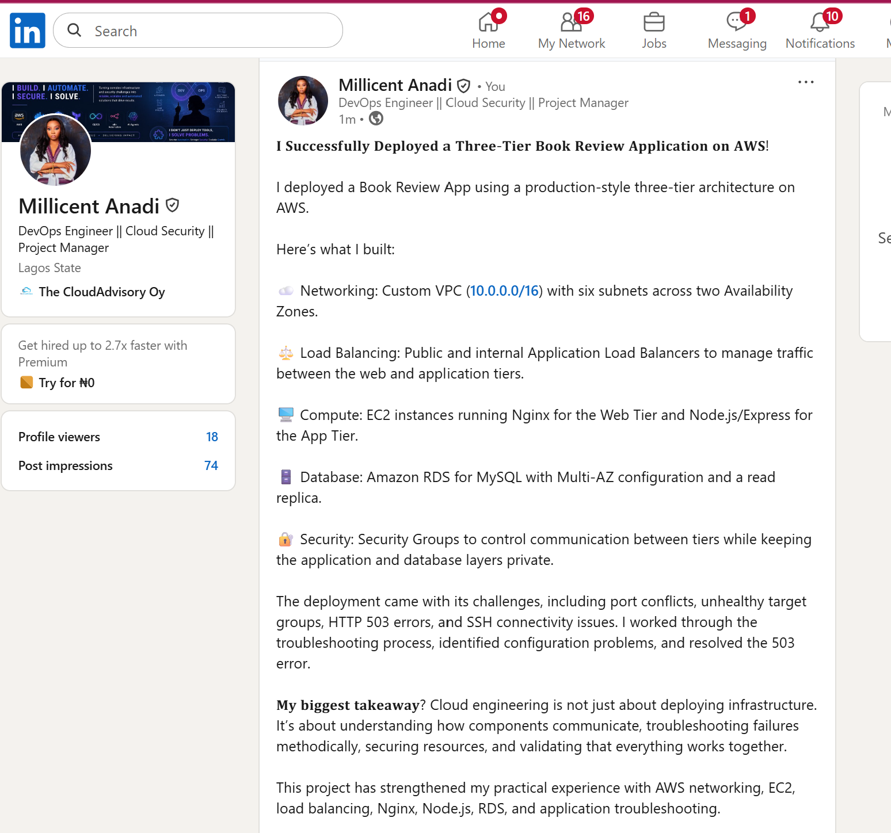

# Assignment 6 — Capstone Assignment — Deploy Book Review App (Three-Tier Architecture) on AWS

Part of the DevOps Micro Internship (DMI) Cohort 3 with Agentic AI

---

## Purpose

This is the most important assignment of the course. You will deploy the Book Review App in a fully production-style three-tier architecture on AWS: a Next.js Web Tier behind Nginx and a public ALB, a private Node.js/Express App Tier behind an internal ALB, and a private Multi-AZ MySQL RDS database with a read replica. You are expected to design, deploy, isolate, debug, and document the result independently.

---

# Task 1 — Architecture Diagram

## Goal

Create an architecture diagram showing the custom VPC (10.0.0.0/16), the six subnets across two Availability Zones (two public Web Tier, two private App Tier, two private Database Tier), the public ALB, Web Tier EC2/Nginx, internal ALB, private App Tier EC2, private Multi-AZ RDS with its read replica, and the permitted traffic flow.

### Evidence

#### Diagram image or link

---

# Task 2 — AWS Region & Services Used

## Goal

Record the AWS Region used and list every AWS service used across networking, compute, load balancing, security, and the database.

### Notes

**Region:**

Europe (Stockholm) — eu-north-1

---

**Services:**

Networking: Amazon VPC, subnets (public and private), route tables, Internet Gateway, Network ACLs.

Compute: Amazon EC2 instances running the Web Tier (Nginx) and App Tier.

Load Balancing: Elastic Load Balancing — Application Load Balancer (Public ALB and Internal ALB).

Security: AWS Security Groups and IAM.

Database: Amazon RDS for MySQL, configured for Multi-AZ high availability with a read replica.

Monitoring: Amazon CloudWatch for instance and application monitoring.

---

# Task 3 — Public Entry Point

## Goal

Confirm the Book Review App loads through the public ALB DNS name.

### Evidence

#### Public ALB DNS

Paste your public ALB DNS name here:

`http://Book-Review-Web-ALB-1116703439.eu-north-1.elb.amazonaws.com`

---

# Task 4 — Evidence Screenshots

## Goal

Capture visual proof of every tier and load balancer.

### Evidence

#### Web EC2

---

#### App EC2

---

#### Public ALB

---

#### Internal ALB

---

#### RDS + Replica

---

#### App UI proof

---

# Task 5 — Summary

## Goal

Summarize what worked in the final deployment, the issues encountered and how each was fixed, and the tools or sources used to research and debug.

### Notes

**What worked:**

Successfully deployed a three-tier AWS Book Review application architecture in the eu-north-1 (Europe–Stockholm) region. The deployment included a custom VPC (10.0.0.0/16), six subnets across two Availability Zones, a public Application Load Balancer, Web Tier EC2 instances running Nginx, an internal Application Load Balancer, private App Tier EC2 instances, and an Amazon RDS MySQL database with Multi-AZ configuration and a read replica. The Web Server and App Server communication was configured through the load balancers, with database access restricted to the application tier.

---

**Issues + fixes:**

SSH connection timeout: Investigated EC2 security groups, public IP addressing, and network connectivity. Port 22 was reachable during one test, but subsequent SSH attempts and EC2 Instance Connect failed. The issue remained unresolved at the last check.

Application returning HTTP 503: The internal ALB returned 503 because the application target was unhealthy. Identified that the Node.js application was attempting to listen on port 3306, which is reserved for MySQL, instead of the expected application port 3001. Updated the application port configuration and restarted the application using PM2.

Unhealthy application target: Investigated the application process and port configuration. The target group subsequently became healthy.

Public ALB returning HTTP 503: Verified that the public ALB listener forwarded traffic to the correct Web Tier target group and confirmed the Web Server target was healthy. Further troubleshooting was still required to identify the remaining cause of the 503 response.

---

**Tools/sources used:**

AWS Management Console: EC2, VPC, subnets, route tables, security groups, Application Load Balancers, target groups, and Amazon RDS.

PowerShell: SSH connectivity tests and Test-NetConnection.

Linux commands: curl, ss, systemctl, and network connectivity checks.

PM2: Node.js application process management and application logs.

Nginx: Web server configuration and reverse proxy troubleshooting.

AWS documentation: Reference material for VPC networking, load balancers, EC2 connectivity, security groups, and RDS configuration.

---

# LinkedIn Post (Required)

## Goal

Publish a LinkedIn post sharing the capstone deployment, including the public ALB DNS (or a redacted screenshot), three to five lines on what you built and why it is production-style, and one proof screenshot.

## Evidence

#### LinkedIn Post URL

Paste your LinkedIn post URL here:

`https://www.linkedin.com/posts/millicent-anadi-b7b93a175_aws-devops-cloudcomputing-ugcPost-7518265671076585472-tXe9/?utm_source=share&utm_medium=member_desktop&rcm=ACoAACmbeQ8Bk7IWiCzNrTecawWZMBxbCmmmG5E`

---

#### Screenshot of LinkedIn post

---

# Submission Instructions

- Add all required screenshots and links in your submission
- Do not expose passwords, RDS credentials, connection strings, private keys, or account IDs

---

# Completion Checklist

- [x] Task 1: Architecture diagram completed
- [x] Task 2: AWS Region and services documented
- [x] Task 3: Public ALB DNS confirmed working
- [x] Task 4: All six evidence screenshots captured (Web Tier, App Tier, both ALBs, RDS + replica, app UI)
- [x] Task 5: Deployment summary completed (what worked, issues/fixes, tools/sources)
- [x] LinkedIn post published and URL submitted
- [x] App Tier and Database Tier confirmed not publicly accessible
- [x] No sensitive data exposed

---

## 📌 About DMI & CloudAdvisory

DevOps Micro Internship (DMI) is a project-based DevOps program run by Pravin Mishra (The CloudAdvisory) focused on real-world execution, systems thinking, and career readiness.

It helps learners build strong DevOps foundations with hands-on experience.

---

## 📌 Resources

- 🌐 DMI Official Website: https://dmi.pravinmishra.com?utm_source=github&utm_medium=readme  
- 🎓 University: https://university.pravinmishra.com?utm_source=github&utm_medium=readme  
- 💬 Discord Community: https://discord.pravinmishra.com?utm_source=github&utm_medium=readme  
- 📝 Blog: https://dmi.pravinmishra.com/blog?utm_source=github&utm_medium=readme  
- ▶️ YouTube Playlist: https://www.youtube.com/playlist?list=PLFeSNDtI4Cho  
- 🔗 Pravin Mishra (LinkedIn): https://www.linkedin.com/in/pravin-mishra-aws-trainer/  
- 🏢 CloudAdvisory (LinkedIn): https://www.linkedin.com/company/thecloudadvisory/

---

*This submission is part of DevOps Micro Internship (DMI) Cohort 3 — Agentic AI Track.*